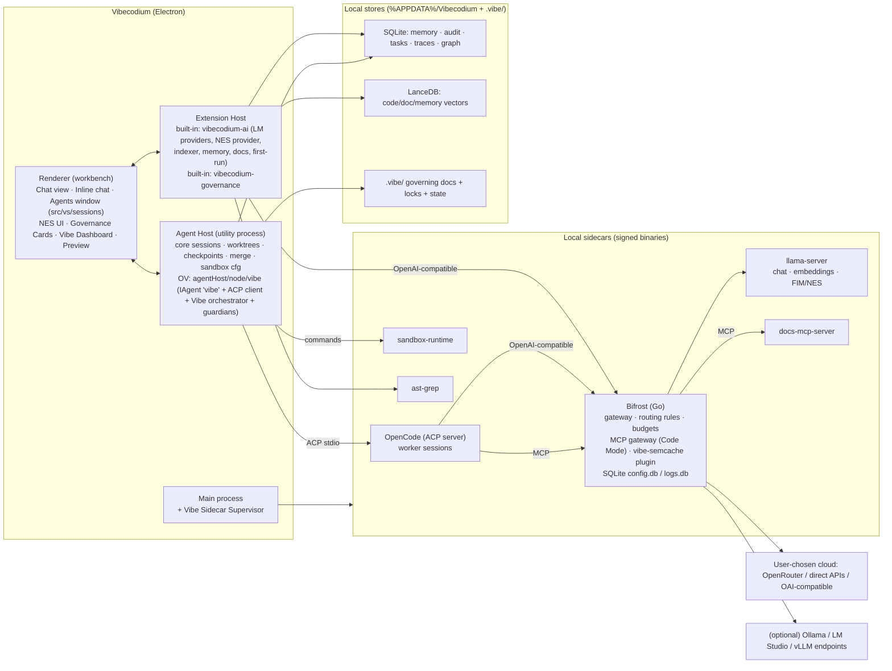

> Doc class: archive · Owner: docs-keeper · Last reviewed: 2026-11-20
>
> Archived research input (2026-11-08). Binding decisions live in `docs/vibe/ARCHITECTURE.md` and `docs/vibe/adr/`. Where this report and an ADR disagree, the ADR wins.

# Vibecodium: Research Report and Architecture Plan

**Report date: 2026-11-08** (sources accessed 2026-11-08 unless noted)
**Engagement:** research and planning only. No implementation code, no patches, no builds.
**Method:** I checked the repo locally (`D:\vibecodium`) and used live web sources: the GitHub REST API (license, `pushed_at`, latest release), raw files at tag `microsoft/vscode@1.143.1`, the Hugging Face model API, npm registry metadata and vendor docs. Six parallel research subagents did the first pass. I re-checked the claims that drive decisions myself. **UNVERIFIED** marks anything I could not confirm live. Health rule: no release or commit in about 6 months means flagged.

---

## 0. Repo verification (my check, local checkout at `D:\vibecodium`)

| Claim in brief | Result | Evidence |
|---|---|---|
| Fork is identical to VSCodium master | ✅ HEAD `ca7f7b4` ("fix: replace removed variable…"), preceded by `081f269 feat(1.143.1): update version` | `git log` |
| Pinned upstream | ✅ `upstream/stable.json` = tag `1.143.1`, commit `e646868227c3e3a9e3f24277c8c7220be42c0be7` | local file |
| Node version | ✅ `.nvmrc` = `24.18.0` | local file |
| Copilot/agent removal | ✅ `patches/52-ext-copilot-remove-it.json` (a `remove` action list: `extensions/copilot`, `agentHost/node/codex`, `agentHost/node/otel`, `agentHost/node/claude/*`, most `agentHost/node/copilot/*`) plus `53-ext-copilot-remove-it.patch` (rewires `agentServiceComposition.ts`, `localModelSetupChannel.ts`, …) | local files |
| JSON "action" patches | ✅ `utils.sh::apply_actions()` runs `remove` actions from `*.json` next to the numbered patches | `utils.sh` |
| **Overlay mechanism (important)** | ✅ `prepare_vscode.sh` line 9: `cp -rp src/stable/* vscode/`. **New files can be added without any patch**, by placing them under `src/stable/...` | `prepare_vscode.sh` |
| User patches | ✅ `patches/user/` gets applied automatically (`readme.txt`) | local |
| Windows build | ✅ `build/windows/{package.sh, prepare_assets.sh, install_inno_update.sh, check_tags.sh, msi/(WiX v3: heat/candle/light), appx/, rtf/}`. Platform patches live in `patches/windows/` | local |
| Toolchain | ✅ `docs/howto-build.md` lists Git for Windows (Git Bash) or WSL2, Node per `.nvmrc`, jq, 7-Zip, Python 3.11, rustup, WiX v3 (MSI only) | local |
| Dev build flags | ✅ `dev/build.sh -i` (insider), `-l` (latest), `-o` (skip build), `-p` (assets), `-s` (skip source) | `dev/build.sh` |
| Open VSX | ✅ `prepare_vscode.sh` line 39 sets `extensionsGallery` to `open-vsx.org` | local |
| VSCodium status | Latest release **1.143.17232 (2026-10-28)**. Upstream VS Code is at **1.145.2 (2026-11-06)**, so VSCodium runs about 2 minors behind. Cadence is monthly. | api.github.com/repos/VSCodium/vscodium, /microsoft/vscode/releases |

### What upstream 1.143.1 actually contains (verified at the tag)

- `src/vs/platform/agentHost/common/` has more than 150 files. Among them: `agent.ts` (`AgentProvider = string`; `IAgent { id, getDescriptor(), authenticate(), dispose() … }`; IDs `claude`, `codex`, `copilotcli`), `agentHostByokLm.ts` (a **BYOK bridge**: the node agent host runs an *OpenAI-compatible proxy* and forwards inference to renderer-side LM-API models), `agentHostCheckpointService.ts`, `agentMerge.ts`, `agentModelPricing.ts`, `autoModeTiers.ts`, `customAgents.ts`, `devContainerAgentHost.ts`, `sandboxConfigSchema.ts`, `toolSearchConstants.ts` (`tool_search_tool`), `otel/`, `otlp/`, `missionControlEnvironment.ts`, `localModel.ts` (**llama-server-based on-device models**, setting `chat.copilot.localModel.llamaServerPath`).
- `src/vs/platform/agentHost/node/shared/` contains `worktreeIsolation.ts` (117 KB), `sessionWorktreeFolders.ts`, `agentMergeServerTools.ts`, `sessionMcpDiscovery.ts`, `loopbackProxyServer.ts`, among others.
- `src/vs/platform/agentHost/node/copilot/` is built on **`@github/copilot-sdk`** (npm: MIT, v1.0.29). That SDK drives the **GitHub Copilot CLI** (`@github/copilot`, *"GitHub Copilot CLI License"*: proprietary, **unmodified redistribution only**). **We cannot base our harness on it.**
- `src/vs/sessions/` is a separate Agents app/window (`contrib/` includes `automations`, `browserView`, `canvases`, `codeReview`, `sessionComparison`, `terminal`, …).
- `src/vs/platform/mcp/common/mcpGateway.ts` exists, so core ships an MCP gateway.
- `src/vs/editor/contrib/inlineCompletions/` (inline/next-edit **UI**) is core.
- **Stable API** (`src/vscode-dts/vscode.d.ts` @1.143.1) includes `lm.registerLanguageModelChatProvider`, `lm.registerMcpServerDefinitionProvider` and `lm.registerTool`. *(This corrects one subagent's claim that the provider API is still proposed.)* Relevant proposals: `chatSessionsProvider`, `chatHooks`, `chatPromptFiles`, `chatProvider`, `languageModelProxy`, `languageModelPricing`, `mcpToolDefinitions`, `inlineCompletionsAdditions`, `defaultChatParticipant`.
- `extensions/copilot/package.json`: `name=copilot-chat`, `version 0.71.0`, `LICENSE.txt` = **MIT**. It contributes LM providers `copilot, copilotcli, anthropic, xai, gemini, openrouter, openai, ollama, customoai, customendpoint, azure`. BYOK sources are at `src/extension/byok/vscode-node/*Provider.ts`. The old repo `microsoft/vscode-copilot-chat` is **archived** (moved in-tree).

---

## 1. Executive summary: the final stack

| # | Component | Winner | Why (one line) | License | 100% local | Paid feature needed? |
|---|---|---|---|---|---|---|
| A1 | AI layer strategy | **Hybrid (c): native VS Code chat/agentHost/sessions UI + our own `vibe` IAgent provider + built-in `vibecodium-ai` extension** | Reuses the MIT UI that Microsoft already maintains. Our code goes into new overlay files, with only a few small "hook" patches | MIT | ✅ | No |
| A2 | Head-start code | **Kilo Code (MIT)** for UX patterns/snippets, **OpenCode (MIT)** as the harness, **Copilot Chat BYOK providers (MIT, in-tree)** | Only MIT sources get vendored. Apache-2.0 code (Cline/Continue) is reference-only or kept with NOTICE | MIT / Apache-2.0 | ✅ | No |
| 3 | Model source | **OpenRouter (default) + any direct/OpenAI-compatible/local provider through the gateway** | One key gives you hundreds of models, `models[]` fallbacks and `/embeddings` | API (BYOK) | n/a | Pay-per-use only |
| 4 | Router | **Bifrost routing rules + complexity router, driven by a Vibe policy table** | OSS tier, in the same binary as the gateway, no extra classifier model | Apache-2.0 | ✅ | No (adaptive routing is Enterprise, so we don't use it) |
| 5 | AI gateway | **Bifrost OSS (Go single binary, SQLite config/logs)** | Fallbacks, virtual-key budgets/rate limits, OTel, plugins. No `enterprise/` dir in the repo | Apache-2.0 | ✅ | No |
| 6 | MCP aggregator | **Bifrost MCP Gateway (Code Mode + tool filtering), plus core `tool_search_tool`** | Context stays at 4 meta-tools however many servers are configured. Measured −92.8% input tokens | Apache-2.0 | ✅ | No |
| 7 | Caching | **Provider prompt caching (passthrough) + `vibe-semcache` Bifrost Go plugin on SQLite + LanceDB/sqlite-vec** | Bifrost's direct (hash) cache is fully local. Its *semantic* mode documents only external vector DBs, so we supply an embedded backend (or Chromem if it proves usable, UNVERIFIED) | Apache-2.0 | ✅ | No |
| 8 | Local runtime | **llama.cpp `llama-server` (bundled) + Ollama auto-detected** | MIT, static binaries for Windows (CUDA/Vulkan/SYCL/ROCm/OpenVINO). Core already speaks llama-server | MIT | ✅ | No |
| 9 | Code indexing | **tree-sitter WASM (already a VS Code dep) + ast-grep + VS Code LSP providers + embeddings → LanceDB** | Zero new native toolchain. Hybrid BM25/vector/symbol retrieval | MIT/Apache | ✅ | No |
| 10 | Knowledge graph | **Native "Vibe Graph" (SQLite tables) with Understand-Anything (MIT) as the vendored skill/visual layer** | UA is MIT, very active (91k★), agent-agnostic. Its storage gets mapped onto our index | MIT | ✅ | No |
| 11 | Vector store | **LanceDB (embedded, Node SDK, Windows prebuilts)** | Active (v0.41.0, 2026-10-29). sqlite-vec is pre-1.0 and quiet since 2026-05 | Apache-2.0 | ✅ | No |
| 12 | Embeddings | **Qwen3-Embedding-0.6B local (Ollama/GGUF), `qwen/qwen3-embedding-4b` via OpenRouter** | Apache-2.0, 32k ctx, strong code retrieval, one model family local and cloud | Apache-2.0 | ✅ | No |
| 13 | Docs/web context | **docs-mcp-server (arabold, MIT, TS)** + Playwright fetch + Trafilatura-style extraction | Self-hosted Context7 alternative, Node-native | MIT | ✅ | No |
| 14 | Agent memory | **Native Vibe Memory (SQLite + LanceDB), API modeled on Hindsight (retain/recall/reflect)** | No Python runtime to ship. Hindsight (MIT) remains an optional sidecar | MIT | ✅ | No |
| 15 | Agent harness | **OpenCode via ACP (`opencode acp`)** behind our `vibe` IAgent provider | MIT, TS, provider-agnostic, stable ACP v1, extremely active | MIT | ✅ | No |
| 16 | Multi-agent | **Core agentHost sessions/subagents + Vibe orchestrator (coordinator → workers, task board in SQLite)** | Native Agents window and session UI already exist in core | MIT | ✅ | No |
| 17 | Isolation | **git worktree per agent (core `worktreeIsolation.ts`) + shadow-git checkpoints + Mergiraf merge driver (optional)** | Same mechanism users know from Cursor `/worktree`, and it's already in core | MIT (+ Mergiraf UNVERIFIED) | ✅ | No |
| 18 | Sandbox | **anthropics/sandbox-runtime (Win/macOS/Linux) + optional devcontainer/Podman tier** | The only open, cross-platform OS-level sandbox (Seatbelt / bubblewrap / restricted-token+WFP) | Apache-2.0 | ✅ | No |
| 19 | Self-verification | **Core integrated browser + chat browser tools, Playwright, chrome-devtools-mcp, core terminal tools** | Built in, so no MCP is needed for the base loop | MIT/Apache | ✅ | No |
| 20 | Skills/rules | **Agent Skills (`SKILL.md`) + `AGENTS.md` + VS Code prompt files/custom agents/hooks** | Cross-vendor standards that core already reads | open | ✅ | No |
| 21 | Anti-drift | **OpenSpec (MIT, TS) specs + Vibe guardian subagents + dependency-cruiser gates + Codex-style auto-review pattern** | Standalone binaries, delta-spec model fits locked docs | MIT | ✅ | No |
| 22 | Tab/NES | **Core inline-completions UI + Vibe NES provider: Sweep next-edit 1.5B (local) / Qwen2.5-Coder-1.5B FIM / any cloud model** | Apache-2.0 open weights, small enough for llama-server | Apache-2.0 | ✅ | No |
| 26 | Extensions | **Open VSX (unchanged)** | Already wired by VSCodium | EPL-2.0 (server) | n/a | No |
| 27 | Telemetry | **OTel GenAI spans → local SQLite trace store + Bifrost `logs.db` → built-in Vibe Dashboard** | Langfuse needs PG+ClickHouse+Redis+S3 and has `ee/`. Phoenix is ELv2 (not OSI) | MIT/Apache | ✅ | No |
| 28 | Security | **SecretStorage (DPAPI/Keychain/libsecret), allow/deny rules on `chat.tools.*.autoApprove`, sandbox-runtime, spotlighting + CaMeL-style quarantine, MCP spec 2025-11-25 practices** | Mostly reuses core. Prompt Guard 2 is optional (Llama 4 license, gated) | mixed | ✅ | No |
| 29 | Packaging | **Keep Inno Setup (exe, Inno 7.1.1) as primary. Freeze WiX v3 MSI and flag it. SignPath Foundation for signing. Own `vibecodium/versions` update feed** | WiX v3 is **archived**. WiX v6+ binaries carry an OSMF fee EULA for revenue-generating users | Inno (free), MS-RL | ✅ | No (SignPath is free for OSS) |

---

## 2. Foundation decision (A1): native layer vs absorb vs hybrid

### Options

| Option | What it means concretely | Patch surface per upstream release | UX quality | Risk |
|---|---|---|---|---|
| **(a) Pure native** | Re-enable VS Code chat/agentHost and use the stripped upstream harnesses as-is | Medium. Revert parts of `52-…json` | Excellent, it's Microsoft's UI | **Blocked**: the Copilot harness depends on `@github/copilot-sdk` → proprietary Copilot CLI (unmodified-redistribution-only license, GitHub auth/CAPI). The Claude harness wraps the Claude Agent SDK (repo has no license / proprietary). The Codex harness carries `codexAccount*.ts` (ChatGPT-account coupling; custom-provider support **UNVERIFIED**) |
| **(b) Absorb an extension** (Kilo Code MIT, Cline Apache-2.0, Continue Apache-2.0; Void and Roo are **archived**) | Ship Kilo/Cline as a built-in webview extension | Low against VS Code (extension API), **high against Kilo upstream** (v7.8.x every few days) | A second, parallel chat UI next to the native one. No Agents window, no native NES, no native sessions/worktrees | Duplicated UX. VS Code's native AI surfaces (which VSCodium hides) stay dead. Two MCP stacks |
| **(c) Hybrid (winner)** | Re-enable **core UI and services** (chat view, inline chat, Agents window `src/vs/sessions`, agentHost sessions/worktrees/checkpoints/MCP/hooks/prompt files/skills, inline-completions UI). Add **our own** `IAgent` provider `vibe` in `agentHost/node/vibe/` (overlay files) that speaks **ACP** to an **OpenCode** sidecar. Add a **built-in extension `vibecodium-ai`** that registers LM providers (stable `lm.registerLanguageModelChatProvider`) pointed at the local **Bifrost** gateway, plus the NES provider, the Vibe Agent UI (governance cards, dashboard, first-run) and indexing/memory services | **Low–medium.** New code lives in overlay files (`src/stable/**`, no patch needed). Hook patches stay small: registering the provider in `agentServiceComposition.ts`, unhiding the chat setup without Copilot, and product.json keys | Native Cursor-class UI, consistent with VS Code | agentHost internals change monthly, so the `IAgent` contract can drift. Mitigation: everything sits behind one adapter file. ACP keeps the harness swappable |

### Why (c) beats (a) and (b)

1. **Licensing makes (a) impossible as-is.** The in-tree Copilot harness needs the proprietary Copilot CLI binary and a GitHub account. The Claude harness needs a proprietary SDK. That breaks the "open source only, no subscription" constraint.
2. **(b) gives up the biggest asset.** VS Code 1.143 already ships worktree isolation, checkpoints, an agent merge, a sandbox config schema, MCP gateway/tool search, hooks, skills, an Agents window and the NES UI. All of it is MIT and maintained by Microsoft. A webview extension would rebuild these and still look like a plug-in.
3. **Patch cost is the deciding cost, and (c) minimizes it.** VSCodium's `cp -rp src/stable/* vscode/` overlay lets us **add whole directories with zero patches**. Only call sites need patches (estimated 4–8 small patches, see §5). With (a), every upstream reshuffle of `copilot/*` and `claude/*` (already 70+ removal paths in `52-…json`) would hit us. With (b), we'd be rebasing on a fast third-party fork.
4. **ACP decouples the harness.** If OpenCode stalls, Goose (Apache-2.0, ACP) or Cline (Apache-2.0, ACP) can be swapped in with configuration changes. ACP schema is v1.29.1 (2026-11-02), wire protocol v1 stable, v2 draft.

### Patch maintenance estimate per upstream release (UNVERIFIED estimate, from file churn)

| Area | Expected conflict frequency | Mitigation |
|---|---|---|
| `agentServiceComposition.ts` registration hook | Every 1–2 releases (VSCodium's `53-…patch` already edits it) | Put our hook *inside* VSCodium's existing patch hunk region and keep it to one line that calls `registerVibeAgent(…)` in an overlay file |
| `IAgent` / `IAgentDescriptor` contract (`common/agent.ts`, 89 KB) | Frequent (monthly) | Adapter layer `vibeAgentAdapter.ts`. CI compile check against upstream `main` weekly (M1 acceptance) |
| Chat setup unhide (`chatSetup*`) | Medium | Prefer **settings/product.json** over code: `chat.disableAIFeatures=false`, plus a minimal setup provider |
| Overlay files | None at apply time, but **compile** breaks on API drift | Typecheck job + `dev/update_patches.sh` in CI |

---

## 3. Per-component research (B–G)

Table column key: **Ver/date** = latest release seen 2026-11-08 · **Health** = last push · **Path** = P (patch) / BE (built-in extension) / OV (overlay core file) / SC (sidecar).

### A2. Head-start repos (license vs MIT)

| Name | Ver/date | License | Health | Cost | Path | Strengths | Weaknesses | Fit |
|---|---|---|---|---|---|---|---|---|
| [Kilo Code](https://github.com/Kilo-Org/kilocode) | v7.8.27 (2026-11-05) | **MIT** | pushed 2026-11-07 | BYOK; hosted upsell optional | Reference/vendor snippets into BE | Only major agent extension under MIT. Mature UX for modes/approvals | Fast-moving and webview-based | Patterns for approval cards and mode UI |
| [OpenCode](https://github.com/anomalyco/opencode) (moved from `sst/opencode`) | v1.19.5 (2026-10-28, latest stable per API) | MIT | pushed 2026-11-08, 225k★ | none | SC (harness) | ACP server, provider-agnostic, plugins, subagents | Bun/TS runtime binary size **UNVERIFIED** | Harness winner (§15) |
| Copilot Chat `extensions/copilot` (in-tree) | 0.71.0 @1.143.1 | MIT | upstream monthly | none for BYOK code | Vendor BYOK provider files into BE | Ready-made OpenRouter/Ollama/custom-OAI/Anthropic/Gemini providers | Coupled to Copilot services/telemetry. Prune carefully | LM provider layer |
| Rejected: Void (archived 2026-06), Roo Code (archived 2026-05-15, org moved to Roomote), Theia AI (EPL-2.0, weak copyleft, needs legal review), PearAI (Continue fork, low activity UNVERIFIED), Continue (Apache-2.0, last *release* a 2026-06-19 prerelease, so an unhealthy release channel), GitNexus (PolyForm Noncommercial) |

**Winner: OpenCode (harness) + in-tree Copilot BYOK providers (MIT) + Kilo (MIT) patterns.** Copying Apache-2.0 code is legal under MIT distribution, but it needs NOTICE files and per-file attribution. I limit it to reference so the license story stays simple.

### B3. Model gateway / aggregator (upstream source)

| Name | Ver/date | License | Health | Cost | Path | Strengths | Weaknesses | Fit |
|---|---|---|---|---|---|---|---|---|
| **[OpenRouter](https://openrouter.ai/docs)** | API, docs live 2026-11-08 | proprietary SaaS | active | Pay-per-use. Platform fee per [pricing](https://openrouter.ai/pricing): 5.5% Standard. BYOK: first $25k/mo free then 5% | Provider entry in Bifrost | Hundreds of models, `models[]` fallback list, provider routing (`order`, `only`, ZDR, `data_collection: deny`), **`/embeddings` (40 models)**, `openrouter/auto` | Free plan: **no prompt caching and no auto-router** (pricing table). Not offline | Default upstream |
| Direct provider APIs (Anthropic, OpenAI, Google, DeepSeek, xAI, …) | live | proprietary | active | Pay-per-use | Bifrost providers | No middleman fee, native prompt caching | One key per vendor | Equal peers in the gateway |
| LiteLLM as aggregator | pushed 2026-11-08 | MIT + `enterprise/` | active, 5.7k open issues | OSS tier | SC (Python) | 100+ providers | Python+PG/Redis expectations | Rejected for the sidecar (§5) |

Rejected/UNVERIFIED: Requesty, Vercel AI Gateway, Together (hosted; features not fetched).
**Winner: OpenRouter as default, but always *through* Bifrost**, so it's one provider row among many (hard constraint: never hardcode a vendor). Test note (S4): an OpenRouter outage gets handled by Bifrost fallbacks to direct keys or local llama-server.

### B4. Intelligent router

What **"Omni-Router"** turned out to be: the name is used by several unrelated projects. Most relevant is [omnilabs-ai/OmniRouter](https://github.com/omnilabs-ai/OmniRouter) (Apache-2.0, ~110–120★, **pre-alpha**). It is *not* an inline router: it shadow-replays traffic against candidate models and emits routing policies for LiteLLM or vLLM-SR. Others: an academic paper (arXiv 2502.20576), Godde3s/omnirouter (free-provider bridge proxy), Fortitude-Group/OmnisRouter (new, Aug 2026), SGLang-Omni router (replica load balancer). **Don't depend on any of them.** The omnilabs "offline eval → policy" idea gets reused in M9 (auto-tuning).

| Name | Ver/date | License | Health | Cost | Path | Strengths | Weaknesses | Fit |
|---|---|---|---|---|---|---|---|---|
| **Bifrost routing rules + [complexity router](https://docs.getbifrost.ai/features/complexity-router)** | v2.5.0 (2026-11-06) | Apache-2.0 | very active | OSS feature | in gateway SC | Declarative CEL routing rules (`complexity_tier == "COMPLEX"`). Classifier is either a *decision model* (default "Typesafe Jev"; self-hosted decision models documented) or *semantic* (reference phrases + embeddings) | Decision-model call costs ~600–800 ms per request (docs), so we use only the semantic classifier or explicit task-class headers. **Adaptive routing is Enterprise-only**. Whether the default decision model is hosted is **UNVERIFIED** | Same binary as gateway and MCP |
| [vLLM Semantic Router](https://github.com/vllm-project/semantic-router) | v0.4.0 (2026-09-27) | Apache-2.0 | pushed 2026-11-08 | none | SC (Go + classifier model) | Learned routing models ("Decision 3.0") | Prefers Envoy/K8s. Classifier download and RAM | Optional upgrade for power users |
| [OpenRouter Auto](https://openrouter.ai/docs/guides/routing/routers/auto-router.md) | live | SaaS | active | Paid plan required (not Free) | per-request model id | Picks model *and* reasoning effort against live prices | Hosted only, fails offline. Paid tier | "Let OpenRouter choose" option |

Rejected: RouteLLM (last push 2024-08-10, abandoned), NotDiamond (hosted API key), LiteLLM Auto Router ("[Add-on]", tier UNVERIFIED), katanemo plano (ex-archgw, Envoy, heavy).
**Winner: Bifrost rules + Vibe policy table.** The Vibe Agent writes the policy table (`task-class → model list + fallbacks + max cost`) into Bifrost config, using task classes the harness already knows: *plan, code-edit, quick-edit/NES, review, summarize, embed*. Routing by task class beats prompt classification: it's deterministic, has zero latency and is explainable in the UI. vLLM-SR loses on footprint. OpenRouter Auto loses on offline mode and the paid tier.

### B5. AI gateway

| Name | Ver/date | License | Health | Cost | Path | Strengths | Weaknesses | Fit |
|---|---|---|---|---|---|---|---|---|
| **[Bifrost](https://github.com/maximhq/bifrost)** | transports v2.5.0 (2026-11-06) | Apache-2.0 (no `enterprise/` dir) | pushed 2026-11-07, 9.4k★ | OSS | SC (Go single binary, `npx`/docker/Go SDK) | Fallbacks, weighted key LB, **virtual keys with budgets and rate limits**, OTel/Prometheus, Go/WASM plugins, **SQLite `config.db`/`logs.db`**, MCP gateway, base-path serving (v2.5.0) | Enterprise-only features: clustering, adaptive LB/routing, circuit breaker, RBAC, audit logs, guardrails, alerting. Latency claims (11 µs) are vendor-only, **UNVERIFIED**. RSS **UNVERIFIED** | Also the MCP and cache host |
| [LiteLLM proxy](https://github.com/BerriAI/litellm) | pushed 2026-11-08 | MIT + `enterprise/` (open core) | 5.7k open issues | OSS tier | SC (Python) | Broadest provider list | Python runtime to ship. PG/Redis for budgets. SSO/audit are Enterprise | #2 |
| [Portkey Gateway](https://github.com/Portkey-AI/gateway) | v1.15.2 (2026-01-12) | MIT | **stale** (push 2026-05-25) | OSS | SC (Node) | Tiny, Node-native | Stale. Enterprise features "merging in 2.0" | #3, flagged |

Rejected: TensorZero (**archived** 2026-06), Helicone ai-gateway (GPL-3.0, stale 2025-11), Kong AI (Postgres plus Enterprise AI plugins).
**Winner: Bifrost.** Compared with LiteLLM it's a single static Go binary (no Python), SQLite by default, and the OSS tier covers budgets and rate limits. Compared with Portkey it's actively maintained and includes an MCP gateway. Failover without the Enterprise circuit breaker: Bifrost `fallbacks` plus our supervisor's health probes (§4 S4).

### B6. MCP aggregator / gateway (context bloat)

| Name | Ver/date | License | Health | Cost | Path | How it avoids context bloat | Weaknesses | Fit |
|---|---|---|---|---|---|---|---|---|
| **[Bifrost MCP Gateway](https://docs.getbifrost.ai/mcp/code-mode.md)** | v2.5.0 (2026-11-06): per-user discovery, MCP Apps, multi round-trip | Apache-2.0 | active | OSS | in gateway SC | **Code Mode exposes 4 meta-tools** (`listToolFiles`, `readToolFile`, `getToolDocs`, `executeToolCode`). The model writes Starlark/Python run in a sandbox. Vendor benchmark: 508 tools/16 servers, 75.1M→5.4M input tokens (−92.8%), pass rate kept. Plus deny-by-default `tools_to_execute`, per-request include headers and per-VK filters | Code-mode quality depends on model coding skill. Starlark sandbox semantics differ from Node | Winner |
| [Docker MCP Gateway](https://github.com/docker/mcp-gateway) | v0.44.3 (2026-10-26, prerelease) | MIT | active | OSS | SC (needs Docker daemon) | Dynamic discovery (`mcp-find`-style) and profiles, per-server containers | Requires Docker Desktop 4.59+ or a daemon, so it fails zero-config | #2 (Docker users) |
| [1mcp](https://github.com/1mcp-app/agent) / [MCPJungle](https://github.com/mcpjungle/MCPJungle) | pushed 2026-11-08 / 2026-11-03 | Apache-2.0 / MPL-2.0 | active | OSS | SC (Node / Go) | Tool groups/filters (curation, not laziness) | No code mode | #3 |

Rejected: MetaMCP (author-flagged maintenance delay, Postgres), mcp-router (**archived, EOL 2026-09-18**), IBM ContextForge (Python+Redis, 1k open issues), tbxark/mcp-proxy (no laziness).
**Core complement:** VS Code core has `tool_search_tool` (`toolSearchConstants.ts`) and `mcpGateway.ts`. The Vibe agent uses **tool search for native tools and Bifrost Code Mode for MCP tools.**
**Winner: Bifrost.** Context cost stays O(1) in server count. #2 adds a hard Docker dependency. #3 only filters.

### B7. Caching

| Name | Ver/date | License | Health | Cost | Path | Strengths | Weaknesses | Fit |
|---|---|---|---|---|---|---|---|---|
| **Provider prompt caching (passthrough)**: Anthropic `cache_control`, OpenAI automatic prefix, Gemini implicit, DeepSeek automatic | live | n/a | n/a | Saves money. **OpenRouter Free plan has no prompt caching** | gateway passthrough | Largest savings for agent loops with stable system prompts | Per-provider thresholds and discounts **UNVERIFIED** | Always on. The harness keeps system and tool prefixes stable |
| **Bifrost `semantic_cache` + our embedded backend** | v2.5.0 | Apache-2.0 | active | OSS | gateway plugin | Exact-hash *and* similarity paths, async writes, persists, covers embeddings too. A **direct-only (hash) mode needs no embeddings** | Semantic mode lists only external stores (Weaviate/Redis-Valkey/Qdrant/Pinecone; architecture/vector-store page). The complexity-router docs mention an embedded **Chromem** directory store, but whether semcache can use it is **UNVERIFIED** (try it first in M10) | Winner, via a custom **`vibe-semcache` Go plugin** using SQLite (+ sqlite-vec) as the store. Bifrost supports custom Go plugins (OSS) |
| LiteLLM caching | live | MIT core | active | OSS | SC | Redis/Valkey semantic cache | Redis required. Python | #3 |

Rejected: GPTCache (last release 2024-08, unmaintained), Redis LangCache (managed, paid).
**Policy:** semantic caching is **off by default for agentic/tool-calling turns**, where stale answers are dangerous, and **on for idempotent calls**: embeddings, doc summaries, commit-message drafts. The Vibe Agent can tune this.

### B8. Local runtime

| Name | Ver/date | License | Health | Cost | Path | Windows | Strengths | Weaknesses |
|---|---|---|---|---|---|---|---|---|
| **[llama.cpp `llama-server`](https://github.com/ggml-org/llama.cpp)** | b12199 (2026-11-08, ~daily) | MIT | very active | none | SC (bundled binary) | ✅ CUDA / Vulkan / SYCL / ROCm / OpenVINO builds | OpenAI-compatible API, `--embeddings`, `/infill` FIM, smallest dependency surface. **Core 1.143 already has llama-server integration** (`localModel.ts`) | No model registry (we build a downloader) |
| [Ollama](https://github.com/ollama/ollama) | v0.40.15 (2026-11-03) | MIT | very active | none | detect user install / optional SC | ✅ `install.ps1` | Model library (`qwen3-embedding:0.6b` etc.), simplest for users | Separate install. Daemon; 4.6k open issues |
| [LocalAI](https://github.com/mudler/LocalAI) | v4.12.1 (2026-10-23) | MIT | active | none | SC (Go) | ✅ | Multi-modal, OpenAI drop-in | Larger. Less IDE-focused |

Rejected for bundling: LM Studio (proprietary app ToS, though it's fine as a *user-installed* endpoint), Foundry Local (proprietary CLI with telemetry), vLLM (**no Windows**), Jan (chat app). Lemonade (Apache-2.0) is offered as an AMD/NPU endpoint preset.
**Winner: bundled llama-server.** It works offline on first run with no second installer. Ollama and LM Studio are auto-detected on `localhost` and added as Bifrost providers.

### C9. Codebase indexing

| Name | Ver/date | License | Health | Path | Strengths | Weaknesses |
|---|---|---|---|---|---|---|
| **[tree-sitter](https://github.com/tree-sitter/tree-sitter) WASM** (VS Code already depends on `@vscode/tree-sitter-wasm@^0.3.1` at 1.143.1) + **[ast-grep](https://github.com/ast-grep/ast-grep)** 0.51.1 (2026-11-02, MIT) + VS Code LSP symbol/reference providers | v0.27.2 (2026-11-07) | MIT | very active | BE (indexer worker) + ast-grep SC binary | No new native ABI. Language-agnostic chunks by symbol. LSP gives precise refs for free | We write chunker and extractor |
| [Continue indexer](https://github.com/continuedev/continue) (`core/indexing/`) | v2.x prerelease | Apache-2.0 | code active, releases stale | reference | Proven incremental hybrid FTS/vector | Coupled to Continue config |
| [Serena](https://github.com/oraios/serena) / SolidLSP | v2.1.0 (2026-10-19) | GPL-3.0 app / **MIT SolidLSP** | active | SC (Python) | Symbol-level semantic editing via LSP | GPL app, Python sidecar |

Rejected: claude-context (Milvus/Zilliz default; push 2026-07), code-index-mcp (single maintainer), SCIP (needs per-language indexers; keep as a future import format).
**Winner: tree-sitter + ast-grep + LSP.** These are already in the product or MIT single binaries, and the index is shared by NES, chat, agents and the graph. Merkle-hash incremental re-index (the claude-context idea).

### C10. Code knowledge graph / repo understanding

The exact **"Understand Anything"** repo: **[Egonex-AI/Understand-Anything](https://github.com/Egonex-AI/Understand-Anything)**, MIT, 91.3k★, v2.9.0 (2026-07-10), pushed 2026-11-07. It's a plugin that turns codebases into knowledge graphs for coding agents (stores under `.ua/` per subagent research). Internal architecture and runtime deps are **UNVERIFIED** in detail, and spike M5 covers them.

| Name | Ver/date | License | Health | Path | Strengths | Weaknesses |
|---|---|---|---|---|---|---|
| **Understand-Anything** | v2.9.0 (2026-07-10) | MIT | active (push 2026-11-07) | vendored skill + webview, data adapter | Huge adoption, agent-agnostic, visual explanations for non-technical users | Release is 4 months old (commits continue). Internals UNVERIFIED |
| [CodeGraphContext](https://github.com/CodeGraphContext/CodeGraphContext) | v0.5.7 (2026-08-08) | MIT | active | SC (Python + embedded Kuzu) | Call graph/dead code queries, MCP | Python runtime |
| [code-graph-rag](https://github.com/vitali87/code-graph-rag) | v0.5.0 (2026-11-03) | MIT | very active | SC | Monorepo focus | Needs Memgraph server |

Rejected: GitNexus (**PolyForm Noncommercial**), Graphiti (needs Neo4j/FalkorDB), Potpie (service shape), DeepWiki-open (wiki generator; keep as a "generate docs" idea).
**Winner: native Vibe Graph (symbols/calls/imports/tests/features in SQLite, built from §9) + Understand-Anything as the explanation/visual layer.** No Python, no graph server. UA's MIT license lets us vendor it. Compared with CodeGraphContext: no Kuzu/Python runtime.

### C11. Vector store

| Name | Ver/date | License | Health | Path | Strengths | Weaknesses |
|---|---|---|---|---|---|---|
| **[LanceDB](https://github.com/lancedb/lancedb)** `@lancedb/lancedb` | v0.41.0 (2026-10-29); 0.42 betas | Apache-2.0 | pushed 2026-11-08 | BE (N-API prebuilt incl. Windows) | Embedded, file-based, vector + FTS + scalar filters, scales past RAM | Native module (N-API is ABI-stable; Electron validation needed). Cloud upsell irrelevant |
| [sqlite-vec](https://github.com/asg017/sqlite-vec) | v0.1.9 (2026-03-31); alpha 0.1.10 (2026-05-18) | Apache-2.0 | **flag: no push since 2026-05-18 (~6 mo)** | SQLite extension | Truly SQLite-class, one file | Pre-1.0, ANN maturing, loadable-extension pain in Electron |
| [PGlite + pgvector](https://github.com/electric-sql/pglite) | pushed 2026-11-04 | Apache-2.0 / PostgreSQL | active | in-process WASM | No native build | WASM memory/perf ceilings; pgvector-in-PGlite maturity UNVERIFIED |

Rejected: Chroma (JS embedded path weak), Qdrant (server; Edge is new), Orama (license NOASSERTION), hnswlib (no Node binding), libSQL (vector functions, no ANN), DuckDB VSS (experimental).
**Winner: LanceDB** for vectors, plus **SQLite** (`@vscode/sqlite3`, already in VS Code) for relational stores: memory, audit, task board, traces. sqlite-vec stays as the semcache fallback store if LanceDB fails on any platform (M4 acceptance).

### C12. Embedding models

| Name | Ver/date | License | Path | Strengths | Weaknesses |
|---|---|---|---|---|---|
| **[Qwen3-Embedding-0.6B](https://huggingface.co/Qwen/Qwen3-Embedding-0.6B)** (local) / `qwen/qwen3-embedding-4b` (OpenRouter) | HF lastModified 2026-04-20 | Apache-2.0 | llama-server `--embeddings` / Ollama `qwen3-embedding:0.6b` (~639 MB) | Strong multilingual and code retrieval, 32k ctx, flexible dims | Repo license field blank (HF says Apache-2.0). Dims differ across sizes (exact dims UNVERIFIED), so indexes are keyed by model id |
| [CodeRankEmbed](https://huggingface.co/nomic-ai/CodeRankEmbed) | 2025-06-24 | MIT | ONNX/transformers.js (GGUF UNVERIFIED) | 137M, 8k ctx, code-specialized, CPU-friendly | `trust_remote_code`, query prefix; release over a year old |
| [nomic-embed-code](https://huggingface.co/nomic-ai/nomic-embed-code) | — | Apache-2.0 | GPU | SOTA open code embedder | 7B is too heavy for default |

Rejected: jina-code-embeddings-1.5b (**CC-BY-NC**), EmbeddingGemma (gated Gemma license), voyage-code (API-only, paid).
**Winner: Qwen3-Embedding.** It's the only family available **both** as a local GGUF and on OpenRouter, so users can move between cloud and offline. Re-embed with the same model or keep the index per model. CodeRankEmbed is the "low-RAM" preset.

### C13. Docs/web indexing and @-mentions

| Name | Ver/date | License | Path | Strengths | Weaknesses |
|---|---|---|---|---|---|
| **[docs-mcp-server](https://github.com/arabold/docs-mcp-server)** | v3.4.1 (2026-10-25) | MIT | SC (Node) behind Bifrost MCP | Self-hosted Context7 alternative. Versioned library docs, local index | Smaller project |
| [Crawl4AI](https://github.com/unclecode/crawl4ai) | v0.9.5 (2026-10-14) | Apache-2.0 | SC (Python + Playwright) | Strong crawler | Python runtime |
| [Trafilatura](https://github.com/adbar/trafilatura) | pushed 2026-11-06 | Apache-2.0 | algorithm reference (Python) | Best offline HTML→text | Python |

Rejected: Context7 (MIT client but **proprietary hosted corpus**), Firecrawl (AGPL-3.0), Jina Reader (remote API), SearXNG (AGPL; optional user-run endpoint only).
**@-mention sources** (all native chat context providers): `@file @folder @symbol @code(graph) @docs(lib@ver) @web(url) @git(diff/commit/PR) @terminal @problems @memory @spec(locked docs) @image @browser(page)`.
**Winner: docs-mcp-server.** It's Node like our stack, MIT, and needs no Python.

### C14. Agent memory

| Name | Ver/date | License | Path | Strengths | Weaknesses |
|---|---|---|---|---|---|
| **Native Vibe Memory** (session = agentHost session DB; project = `.vibe/memory/*.md` + SQLite index; long-term user = `%APPDATA%` SQLite + LanceDB) | to build | MIT | BE | No Python. Plain-Markdown, reviewable project memory. Shared index | We build consolidation |
| [Hindsight](https://github.com/vectorize-io/hindsight) | v1.2.0 (2026-11-03) | MIT | optional SC (Python embedded mode, Node client) | retain/recall/reflect model, strong LongMemEval claims | Python runtime; cloud upsell |
| [Cognee](https://github.com/topoteretes/cognee) | v1.6.7 (2026-11-06) | Apache-2.0 | SC (Python; LanceDB + embedded graph) | Embedded vector+graph | Heavy pipeline, 1.1k issues |

Rejected: Basic Memory (AGPL-3.0), Mem0 (open-core drift), Letta (server-shaped; release 2026-05), Graphiti (Neo4j), memU (license unclear), A-MEM (research, stale).
**Winner: native.** Its API mirrors Hindsight (retain/recall/reflect), so Hindsight can be plugged in later via MCP without changing callers. Memories are typed: *fact, decision, preference, pitfall* (each with source and date), and **governing docs outrank memories** whenever they conflict.

### D15. Autonomous agent harness

| Name | Ver/date | License | Lang | Provider-agnostic | ACP | Strengths | Weaknesses |
|---|---|---|---|---|---|---|---|
| **[OpenCode](https://github.com/anomalyco/opencode)** | v1.19.5 (2026-10-28) | MIT | TS | ✅ OpenAI-compatible | ✅ `opencode acp` | Largest community, plugins, subagents, permission model | Pace of change. Binary size UNVERIFIED |
| [Goose](https://github.com/aaif-goose/goose) (Linux Foundation AAIF) | v1.57.0 (2026-10-28) | Apache-2.0 | Rust | ✅ | ✅ | Foundation governance, MCP-first | Rust, so harder for us to patch |
| [Cline core/CLI/SDK](https://github.com/cline/cline) | v4.1.26 (2026-10-26) | Apache-2.0 | TS | ✅ | ✅ | Agent teams, checkpoints | Teams are CLI-only; account-tied free tier |

Also seen: OpenHands v1.37.0 (MIT, Python/TS, server-shaped), Codex CLI rust-v0.167.0 (Apache-2.0; custom providers UNVERIFIED), pi (MIT). Rejected: Claude Agent SDK (no OSI license), Plandex (stale ~13 mo), Aider (stale since 2026-05).
**Winner: OpenCode over ACP.** It's MIT and TS, so we can patch it. Goose is Rust (higher patch cost). Cline gates teams to the CLI and uses an account-tied free tier. Long-horizon loop (Vibe-owned, harness-executed): **plan (spec delta) → task graph → execute in worktree → verify (tests/browser/guardians) → checkpoint → report**. Persisted in SQLite so it survives restarts.

### D16. Multi-agent orchestration

| Name | Ver/date | License | Path | Strengths | Weaknesses |
|---|---|---|---|---|---|
| **Core agentHost sessions + Agents window + Vibe orchestrator** | 1.143.1 | MIT | OV + BE | Native parallel sessions UI, subagents, session comparison, mission-control concepts in core | Core Copilot coupling must be avoided |
| Cline agent teams (`/team`, `teams.db`) | live docs | Apache-2.0 | reference | Coordinator, task board, mailbox | CLI-only |
| LangGraph / crewAI | pushed 2026-11-08 | MIT | rejected (Python) | Durable graphs | Not editor-native |

Rejected: Vibe Kanban (**sunsetting**), claude-squad (AGPL), Crystal→Nimbalyst (slowed), uzi (stale).
**Winner: core + Vibe orchestrator.** Default concurrency is auto: `min(4, cores/2, budget)`. Roles: coordinator (the Vibe Agent), workers (OpenCode sessions), guardians (read-only subagents).

### D17. Staging isolation, checkpoints, merge

| Name | Ver/date | License | Strengths | Weaknesses |
|---|---|---|---|---|
| **git worktree per agent** (core `worktreeIsolation.ts`, `sessionWorktreeFolders.ts`, `agentMerge.ts`) | 1.143.1 | MIT | Native, users understand branches, cheap | Shares `node_modules`/ports, so per-worktree env and port allocation are needed |
| [Jujutsu](https://github.com/jj-vcs/jj) workspaces | v0.47.1 (2026-11-05) | Apache-2.0 | Operation log = universal undo; first-class conflicts | Users must accept a jj-colocated repo |
| [container-use](https://github.com/dagger/container-use) | v0.4.2 (2025-08-19) | Apache-2.0 | Container+branch per agent | **Release flag (>1 yr)**; Docker |

Checkpoints: shadow-git (Cline pattern) per session plus core `agentHostCheckpointService`. Merge: core `agentMerge` (LLM merge) + optional [Mergiraf](https://mergiraf.org) structural merge driver (v0.20.0, 2026-09-26; **license UNVERIFIED**, run as a separate binary only) + GitButler (license NOASSERTION, rejected).
**Winner: worktrees.** jj loses on user familiarity and container-use on staleness and the Docker dependency.

### D18. Sandboxing

| Name | Ver/date | License | Platforms | Strengths | Weaknesses |
|---|---|---|---|---|---|
| **[sandbox-runtime](https://github.com/anthropics/sandbox-runtime)** | v0.0.81 (2026-10-20) | Apache-2.0 | Win (restricted token + **WFP egress fence**), macOS (Seatbelt), Linux (bubblewrap) | OS-level, low overhead, TS | Pre-1.0. Windows install creates a per-machine sandbox account (**needs elevation**, so it's an installer step) |
| devcontainers CLI + Docker/Podman | pushed 2026-11-05 | MIT / Apache-2.0 | all (Win via WSL2/VM) | Full env reproducibility | Heavy; not zero-config |
| [microsandbox](https://github.com/superradcompany/microsandbox) | v0.7.13 (2026-11-01) | Apache-2.0 | Win/macOS/Linux microVM | Strong isolation | Young; hypervisor requirements |

Rejected: Firecracker/gVisor (Linux-only), Apple container (macOS-only), Windows Sandbox (not on Home), Daytona (**archived**), E2B (cloud), DevPod (stale).
**Winner: sandbox-runtime** as the default tier. devcontainers is the "max isolation" tier. Core already has a sandbox config schema (`sandboxConfigSchema.ts`, `sessionSandbox.ts`) that we feed.

### D19. Self-verification

Winner set (no competition needed, all used together): **core integrated browser + chat browser tools** (gated by `workbench.browser.enableChatTools`; docs for 1.145 list tools `openBrowserPage`, `screenshotPage`, `runPlaywrightCode`, …; availability at 1.143.1 is **UNVERIFIED**), **Playwright** v1.65.0 (2026-11-05, Apache-2.0), **chrome-devtools-mcp** v1.12.0 (Apache-2.0), **core terminal tools**, **VS Code Testing API** to discover and run tests. Alternatives: Playwright MCP v0.0.84, Stagehand (MIT), browser-use (Python).
**Live preview:** the Vibe preview panel (core browser view) gets auto-wired to the dev-server port detected by the terminal port-forwarding service.

### D20. Skills and rules

| Standard | Status | Use |
|---|---|---|
| **Agent Skills** (agentskills.io, `SKILL.md` folders, 3-stage progressive disclosure) | Cross-vendor; adopted by Cursor, Cline, Codex, VS Code (VS Code page **UNVERIFIED**) | Built-in Vibe skills ship in the product. Project skills go in `.agents/skills/` or `.github/skills/` (exact path conventions UNVERIFIED per harness) |
| **AGENTS.md** (agents.md, LF) | 60k+ projects | Mandatory project file; nested closest-wins |
| VS Code instructions/prompt files/custom agents/hooks (hooks = **Preview**) | core | Hooks are the enforcement point for locked docs |

### D21. Anti-drift agents

| Name | Ver/date | License | Strengths | Weaknesses |
|---|---|---|---|---|
| **[OpenSpec](https://github.com/Fission-AI/OpenSpec)** | v1.16.1 (2026-11-07) | MIT | TS, standalone binaries incl. Windows, **delta specs + strict archive validation**, which maps onto change cards | Methodology lock-in |
| [Spec Kit](https://github.com/github/spec-kit) | v1.3.2 (2026-11-06) | MIT | Canonical spec→plan→tasks | Python |
| [BMAD-METHOD](https://github.com/bmad-code-org/BMAD-METHOD) | v6.12.4 (2026-10-14) | NOASSERTION | Role agents (PM/architect/QA) | License unclear |

Patterns adopted: Codex **auto-review** (a separate reviewer adjudicates approvals), Kiro specs/steering/property tests (closed source, so pattern only), dependency-cruiser v18.7.2 (MIT) and ArchUnit-style gates, `anthropics/claude-code-security-review` (MIT, **stale since 2026-02**, prompts reference only), task-master (stale).
**Vibe guardian set** (read-only subagents, cheap model by default, each with a checklist skill):
1. **Spec-compliance**: diff vs `SPEC.md` acceptance criteria.
2. **Architecture guardian**: `ARCHITECTURE.md` rules → dependency-cruiser config plus an LLM check.
3. **QA verifier**: runs tests/browser; refuses "done" without evidence.
4. **Scope-creep detector**: files and features touched vs the task card.
5. **Security reviewer**: secrets, injection, dependency licenses.
6. **Progress tracker**: updates `.vibe/state/progress.json`; must-have burndown.

### E22. Tab autocomplete / next-edit prediction

| Name | Ver/date | License | Type | Strengths | Weaknesses |
|---|---|---|---|---|---|
| **[Sweep next-edit 1.5B](https://huggingface.co/sweepai/sweep-next-edit-1.5B)** | HF 2026-01-22 | Apache-2.0 | **next-edit** | Small, NES-native | Low adoption (~1.2k downloads). GGUF/prompt format **UNVERIFIED** |
| [Zeta-2](https://huggingface.co/zed-industries/zeta-2) (Zed) | HF 2026-03-23 | Apache-2.0 | next-edit | Battle-tested design (Zeta 1: 520k downloads) | Size and serving format UNVERIFIED |
| [Qwen2.5-Coder-1.5B](https://huggingface.co/Qwen/Qwen2.5-Coder-1.5B) (FIM) | 2024-11-18 | Apache-2.0 | FIM | Ubiquitous GGUF, llama-server `/infill` | Old. FIM only |

Also: JetBrains Mellum-4b-base (Apache-2.0, 2025-05, FIM), llama.vscode v0.0.77 (MIT, 2026-11-05; reference FIM client and ring-buffer context). Rejected: Codestral (license `other`/MNPL), StarCoder2 (OpenRAIL-M use restrictions), Tabby (NOASSERTION/open-core, last release tag 2023), Mercury (API only).
**Winner: Vibe NES provider** (inline completions API, stable) with a model ladder: **Sweep-1.5B local NES → Qwen2.5-Coder FIM fallback → cloud fast model via Bifrost (NES-class route)**. Sweep beats Zeta-2 because it's verified small (1.5B) for CPU/iGPU, and it beats Qwen FIM because it predicts *edits*, not just insertions. M7 includes an offline benchmark harness that can flip the winner.

### E23–25. See §6 (Cursor parity matrix).

### F26. Extensions
Keep `extensionsGallery` → Open VSX (set in `prepare_vscode.sh` line 39). The Microsoft Marketplace terms reportedly restrict use to Microsoft products (exact quote **UNVERIFIED** this session; VSCodium's long-standing reason for Open VSX). Built-in Vibe features are **built-in extensions** (shipped in `extensions/`), not gallery installs. Open VSX 2025–26 policy specifics (rate limits, scanning) are **UNVERIFIED**.

### F27. Telemetry / observability

| Name | Ver/date | License | Storage | Verdict |
|---|---|---|---|---|
| **OTel GenAI spans (core agentHost `otel/`, `otlp/`) → Vibe SQLite exporter + Bifrost `logs.db` → Vibe Dashboard webview** | semconv repo `open-telemetry/semantic-conventions-genai` (Apache-2.0, created 2026-05-05, status **Development**) | Apache/MIT | SQLite | **Winner**: embedded, offline, no MS telemetry |
| OpenLLMetry | — | Apache-2.0 | none (SDK) | #2: instrumentation for sidecars |
| OpenLIT | 2.1.1 (2026-10-26) | Apache-2.0 | ClickHouse required | #3: opt-in external |

Rejected: Langfuse (MIT core + `ee/`; needs Postgres + ClickHouse + Redis + S3), Arize Phoenix (**ELv2, not OSI**; it is the only SQLite-native one, but it fails "open source only"), Opik (MySQL+ClickHouse+Redis+ZK+MinIO).
Rules: VSCodium's `00-telemetry-disable.patch` stays. Vibe traces are **local-only, on by default for the local dashboard** (cost/tokens) and **never** uploaded. Export to OTLP is an explicit opt-in. Note: VSCodium removes `agentHost/node/otel` today, so we re-add our own exporter as an overlay. Pin semconv versions because names are still changing.

### F28. Security

| Concern | Choice | Notes |
|---|---|---|
| Secrets | Core `SecretStorage` (Electron `safeStorage`) | Windows DPAPI is **user-scoped, not app-scoped**. Linux `basic_text` backend means plaintext, so we warn. Electron ≥45 deprecates sync APIs (removed in 46), so use the async APIs |
| Permission prompts | Core approvals: `chat.tools.terminal.autoApprove` (regex/object rules, `false` wins), `chat.tools.global.autoApprove`, `chat.tools.urls.autoApprove`, `chat.agent.sandbox.enabled` | Docs say auto-approve is "**not a security boundary**", so the sandbox is the boundary |
| Command allow/deny | Vibe presets: *Safe* (read-only auto), *Builder* (workspace writes plus package managers in sandbox), *Autopilot* (all in sandbox; network allowlist) | Stored in workspace settings. Shown on a settings card |
| Prompt injection (MCP/web) | **Spotlighting** (tagging untrusted content), **quarantined-reader pattern** (CaMeL-style: untrusted content is summarized by a tool-less model; only the privileged planner calls tools), MCP tool-description pinning (hash on first approval; prompt on change), egress allowlist in sandbox | CaMeL repo is a research artifact (2025-06), so we adopt the pattern, not the code. **Prompt Guard 2** (22M/86M) is optional: Llama 4 license, gated, *not OSI*, offered as a user download. llm-guard is **archived**. mcp-scan is now `snyk/agent-scan` (uploads to Snyk), so it's rejected for local-first |
| MCP auth | Follow MCP spec security best practices **2025-11-25** (confused deputy, no token passthrough, SSRF, session hijack) | Bifrost per-user OAuth (v2.5.0) |
| Command filter | VSCodium already has `00-security-add-command-filter.patch` | Extend for agent-invoked commands |

### F29. Packaging, updates, signing (Windows)

| Item | Finding | Decision |
|---|---|---|
| Inno Setup (`build/windows/install_inno_update.sh`) | Latest **is-7_1_1 (2026-10-28)**; GitHub license NOASSERTION (Inno license historically permissive; **verify**) | Primary installer (user and system setup) |
| WiX | **wix3 repo archived** (last release 3.14.1, 2024-03-23). VSCodium MSI uses v3 `heat/candle/light`. WiX **v7.0.1 (2026-10-26)** binaries carry the **Open Source Maintenance Fee EULA** (fee applies to revenue-generating users) | Freeze MSI on v3 for now, flag it. Open decision: drop MSI, pay OSMF, or build WiX from MS-RL source |
| Signing | **SignPath Foundation: free for OSS** (HSM-held key; signpath.org). Azure Artifact Signing: paid, eligibility limits (price **UNVERIFIED**). Certum OSS cert: low cost (price **UNVERIFIED**) | SignPath via CI; `patches/windows/59-build-replace-signature.patch` already exists for signature handling |
| Updates | VSCodium pattern: `updateUrl` → `VSCodium/versions/.../stable/win32/x64/{user,system}/latest.json` (verified: `{url,name,version,productVersion,hash,timestamp,sha256hash}`) | Fork as `ynotfins/vibecodium-versions`; set `updateUrl` in `prepare_vscode.sh` |
| Sidecar binaries | bifrost.exe, llama-server.exe (CPU/Vulkan default; CUDA as an optional download), opencode.exe, ast-grep.exe, srt-win | Bundled under `resources/app/vibe/bin/<platform>`, each signed. SHA-256 pinned in `vibe-sidecars.json` |
| Distribution | winget (`VSCodium.VSCodium` exists as the pattern) | `Vibecodium.Vibecodium` manifest later |

### G30. Gaps a shippable Cursor+Devin IDE also needs

1. **First-run model provisioning**: GPU/RAM probe → choose a local model ladder → resumable downloads with checksums.
2. **Project templates / scaffolder** for non-technical users (Next.js+auth+SQLite, FastAPI, …) as skills, not hardcoded.
3. **Local "deploy/share" story** (the Cursor Live Apps equivalent): `docker compose`/static export plus optional user-chosen hosts (BYO credentials). **No Vibecodium cloud.**
4. **Secrets for generated apps** (`.env` management, never sent to models: env redaction in the gateway).
5. **Port and process manager** for N worktrees (dev servers per agent).
6. **Cost guardrails UI**: per-task and per-day budgets via Bifrost virtual keys, with hard stops.
7. **Crash/restart supervisor** for sidecars, with health dashboard.
8. **Accessibility and i18n** of all Vibe UI. Keyboard-first governance cards.
9. **Voice input** (dictation) via local whisper.cpp (MIT; **UNVERIFIED** version this session). Cursor shipped voice chat 2026-11-06.
10. **License/compliance scanner** for generated dependencies.
11. **Eval harness** for our own prompts/skills (regression on upgrades).
12. **Session export/import and handoff** (Markdown transcript plus diffs).
13. **Remote/SSH/WSL agent host**: core has `sshRemoteAgentHost.ts` and `tunnelAgentHost.ts`; VSCodium removes some tunnel bits.
14. **Mobile/background notifications** (OS notifications when agents finish or need approval).

---

## 4. Mental-model integration tests

Stack under test: **W** = winners. For each scenario I trace the path, list what breaks, then score the swaps.

### S1. "Build me a SaaS dashboard with auth" (non-technical user)
1. **First run:** the card asks for an OpenRouter key *or* "Use local". The key goes to SecretStorage → Bifrost provider row. Supervisor starts bifrost, llama-server (embeddings), docs-mcp.
2. **Prompt → Vibe Agent** (agentHost `vibe` provider). It detects an empty workspace, runs the **Idea→Spec skill** and asks 3–5 plain-language questions (auth type, data, look).
3. **Governing docs generated** (VISION, SPEC with must-haves and acceptance tests, ARCHITECTURE, …) and shown as **approval cards**. User approves → docs locked (hash in `.vibe/locks.json`).
4. **Plan → task graph** (OpenSpec changes). The router sends plans to a strong model and code edits to a mid model.
5. **Workers** (OpenCode via ACP, 2–3 in parallel worktrees): scaffold, auth, dashboard UI. Tools are native file/terminal/MCP via Bifrost Code Mode. Package installs run in sandbox-runtime with the network allowlist (npm registry).
6. **Verify:** QA guardian runs `npm test`, starts the dev server, the **preview panel** opens and browser tools take a screenshot and click through login. Failures loop back.
7. **Merge** worktrees → main via core agentMerge. Checkpoint. Progress card: "5/7 must-haves shipped".
**Breaks/risks:** (a) sandbox network allowlist blocks the package CDN, so the allowlist UX must be inline ("Allow registry.npmjs.org?"); (b) the Windows sandbox account needs elevation on first use, so it moves into the installer; (c) a free OpenRouter plan means no prompt caching, so cost is higher, which the dashboard shows.
**Swaps:** OpenCode→Goose: equal function, but Rust patching is harder (UX same). →Cline: team features are CLI-only, so orchestration is ours anyway. Bifrost→LiteLLM: adds a Python runtime (+~100s of MB, UNVERIFIED) and slower cold start. →Portkey: no MCP Code Mode, so context rises. sandbox-runtime→devcontainers: Docker install breaks zero-config. **Winner holds.**

### S2. Five parallel agents on one repo
Coordinator splits by **file-ownership hints from the Vibe Graph** to minimize overlap. Each worker gets a worktree, `PORT=base+i` and a separate `node_modules` (or pnpm store hardlinks). Guardians run per worktree. Merge order is topological by dependency. Conflicts go through Mergiraf (if enabled), then the core agentMerge LLM merge, then **human conflict card** if tests fail post-merge.
**Breaks:** disk usage (5× `node_modules`). Mitigation: pnpm/hardlinks and a "shared deps" mode. Lockfile conflicts get regenerated, not merged. Two agents edit the same migration file: the coordinator serializes "hot files".
**Swaps:** worktrees→jj: better conflict model and undo, but users must accept jj and the git-only tools break. →container-use: stronger isolation, but needs Docker and the release is stale. **Worktrees hold**, with jj kept as an advanced option later.

### S3. 40 MCP servers configured
Model context receives: **core native tools after tool search** (only `tool_search_tool` plus ~10 always-on tools), plus **Bifrost Code Mode's 4 meta-tools**, plus **≤100-token skill metadata** entries. Tool *descriptions* for the 40 servers never enter context unless `readToolFile`/`getToolDocs` is called. Per-task **include filters** (`x-bf-mcp-include-clients`) narrow it further. The Vibe Agent writes these from the task card.
**Breaks:** weak local models write bad Starlark. Mitigation: for local-only sessions, switch to "filtered direct tools" (top-k tools by embedding similarity, max 15).
**Swaps:** →Docker MCP Gateway: similar laziness, but needs Docker. →1mcp/MCPJungle: all tools of a group still go into context (+tens of k tokens), so context efficiency fails. **Bifrost holds.**

### S4. OpenRouter outage or rate limit mid-task
Bifrost gets 429/5xx → `fallbacks` (per task class, configured by Vibe: e.g. OpenRouter model → direct Anthropic/OpenAI key if present → local llama-server model). The harness sees a continuous stream. The supervisor marks the provider degraded for N minutes and shows a toast: "Switched to <model> (OpenRouter rate-limited)". Budget limits are enforced by virtual key.
**Breaks:** a mid-stream failure can't be transparently resumed, so the harness retries the turn (idempotent tool calls only; checkpoints guard file edits). Prompt-cache warmth is lost. Smaller local models can't continue a big-context task, so Vibe **compacts** the session before failing over to local. Enterprise circuit breaker is unavailable, so the supervisor implements simple health probes.
**Swaps:** LiteLLM has a similar fallback router (OSS) but adds Python. Portkey: fallbacks fine, project stale. **Holds.**

### S5. Agent drifts from spec
Detection: (1) the scope-creep guardian on each checkpoint (files outside the task card, new deps not in ARCHITECTURE); (2) a spec-compliance diff on "done" claims; (3) dependency-cruiser rules in CI; (4) locked-doc hook denies edits. Correction: the guardian files a **finding** → Vibe Agent tells the worker to revert or justify. Escalation: a repeat (×2) or any locked-doc conflict produces a **decision card** for the user (Approve change / Reject / Acknowledge). Everything is logged to `.vibe/audit.log`.
**Breaks:** guardians on cheap models give false positives, so findings are rated by severity and only `high` blocks. Locked-doc bypass via the shell (`echo > SPEC.md`): sandbox write-deny on locked paths (sandbox-runtime FS rules) plus a hash check at checkpoint.
**Swaps:** OpenSpec→Spec Kit: Python dependency, same pattern. →BMAD: unclear license. **Holds.**

### S6. Offline, local models only
Bifrost providers: llama-server (chat + embeddings + FIM), Ollama if present. Router policy "offline" picks local models per task class. Code Mode → filtered direct tools (S3). docs-mcp serves previously indexed docs only. `@web` is disabled with a notice. Memory, index, graph, telemetry, audit are all local already.
**Breaks:** quality. Long-horizon autonomy with ≤14B models is weak, so Vibe lowers parallelism to 1–2, tightens task granularity and requires tests per step. Hardware: below roughly 16 GB RAM only small models fit (threshold UNVERIFIED), so first-run advises. NES latency on CPU: the 1.5B model is borderline (benchmarks in M7).
**Swaps:** llama.cpp→Ollama: equal function, extra install. →LocalAI: equal, bigger. **Holds.**

### S7. Upstream VS Code release (e.g. 1.143 → 1.145)
Pipeline: `update_upstream.sh` bumps `stable.json` → apply VSCodium patches (VSCodium upstream rebases these for us when we merge `VSCodium/vscodium` master) → apply `patches/vibe/*` → overlay copy → compile.
**Pain points:** (1) the `52-…json` remove list fails with exit 4 when a path disappears (`apply_actions` errors on "Not found"). VSCodium fixes their own, our additions must be minimal. (2) `IAgent`/`IAgentDescriptor` signature changes break overlay compile, fixed in one adapter file. (3) chat setup unhide patch conflicts. Expected effort: **0.5–2 days per monthly release** (estimate, UNVERIFIED). Merging VSCodium master first absorbs most of it.
**Swaps:** strategy (b) (absorb Kilo) would mean lower VS Code conflict but continuous Kilo rebases, plus the duplicated UI. Strategy (a) would mean far higher conflict (all copilot/claude paths). **Hybrid holds.**

### Swap scorecard (1 = much worse … 5 = winner-equivalent)

| Component | #2 swap | Compat | Latency | Context | Failure | License | Patch | UX | #3 swap | Overall |
|---|---|---|---|---|---|---|---|---|---|---|
| Gateway | LiteLLM | 4 | 3 | 4 | 4 | 3 (open core) | 5 | 3 | Portkey (2: stale) | Bifrost wins |
| MCP | Docker GW | 3 | 4 | 5 | 3 | 5 | 5 | 2 | 1mcp (context 2) | Bifrost wins |
| Harness | Goose | 5 | 4 | 4 | 4 | 5 | 3 | 4 | Cline (teams CLI-only, 3) | OpenCode wins |
| Vector | sqlite-vec | 4 | 3 | 5 | 3 (alpha) | 5 | 4 | 5 | PGlite (3) | LanceDB wins |
| Local RT | Ollama | 5 | 5 | 5 | 4 | 5 | 5 | 3 (2nd install) | LocalAI (4) | llama.cpp wins |
| Sandbox | devcontainers | 4 | 2 | 5 | 4 | 5 | 5 | 2 | microsandbox (3) | srt wins |
| Isolation | jj | 3 | 5 | 5 | 5 | 5 | 4 | 3 | container-use (2) | worktree wins |
| NES model | Zeta-2 | 4 | ? | 5 | 4 | 5 | 5 | ? | Qwen FIM (3) | **provisional**, re-test M7 |

No test changed a winner. **Two winners were revised during testing:** semantic cache (Bifrost's built-in needs an external vector DB → custom embedded plugin) and MCP for offline (Code Mode → filtered direct tools when the model is weak).

---

## 5. Architecture

### 5.1 System diagram

### 5.2 Process model

| Process | Responsibilities | New code location |
|---|---|---|
| **Main** | Sidecar supervisor (spawn/health/restart, port allocation, checksum verification), SecretStorage broker, update | `src/stable/src/vs/code/electron-main/vibe/` (overlay) + 1 hook patch in main startup |
| **Renderer** | Native chat/agents UI; Vibe views (governance cards, dashboard, first-run, settings hub) as workbench contributions *or* extension webviews | Prefer extension webviews (zero patch). Workbench contribution only where a native modal is required (card popup), under `src/stable/src/vs/workbench/contrib/vibe/` |
| **Extension host** | `vibecodium-ai`: LM providers → Bifrost (`lm.registerLanguageModelChatProvider`), NES provider, indexer worker, memory, @-mention context providers, docs. `vibecodium-governance`: lock files, cards, audit | `src/stable/extensions/vibecodium-ai/`, `src/stable/extensions/vibecodium-governance/` |
| **Agent host** | `vibe` IAgent provider (ACP client to OpenCode), Vibe orchestrator (task graph, coordinator), guardians, locked-doc hook | `src/stable/src/vs/platform/agentHost/node/vibe/` + registration patch |
| **Sidecars** | Bifrost, OpenCode, llama-server, docs-mcp, sandbox-runtime, ast-grep | binaries fetched in build, placed in `resources/app/vibe/bin/` |

### 5.3 Key data flows
- **Inference:** any UI/agent → Bifrost `:<port>/v1` (virtual key per feature: `vk-chat`, `vk-agent`, `vk-nes`, `vk-guardian`, `vk-embed`) → routing rule (task class) → provider (+fallbacks) → stream back. Logs go to `logs.db` → dashboard.
- **Context:** indexer (tree-sitter/ast-grep/LSP) → chunks → embeddings (`vk-embed`) → LanceDB. Graph edges → SQLite. Chat/agent retrieval = hybrid (FTS + vector + graph neighbors) under a token budget set by the Vibe Agent.
- **Tools:** native tools (core) + MCP via Bifrost aggregate `/mcp` (Code Mode). All shell execution goes through sandbox-runtime, with auto-approve rules applied first.
- **Governance:** a proposal from the Vibe Agent becomes a `ChangeCard{doc, before, after, plain, benefits, risks}` → renderer modal → decision → audit append (JSONL with hash chaining) → apply edit with lock update.

### 5.4 Exactly where each piece lives in the VSCodium repo

| Path (repo root) | What | Patch or overlay |
|---|---|---|
| `product.json` (root, merged by `prepare_vscode.sh` line 126) | `nameShort/nameLong=Vibecodium`, `applicationName=vibecodium`, `dataFolderName=.vibecodium`, win32 IDs (new GUIDs), `extensionEnabledApiProposals` for `vibecodium.vibecodium-ai` (`chatProvider`, `chatSessionsProvider`, `chatHooks`, `languageModelProxy`, `inlineCompletionsAdditions`, `defaultChatParticipant`, …), `defaultChatAgent` → Vibe (**exact fields UNVERIFIED**) | JSON edit |
| `prepare_vscode.sh` / `utils.sh` | `APP_NAME=Vibecodium`, `BINARY_NAME=vibecodium`, `GH_REPO_PATH=ynotfins/vibecodium`, `updateUrl` → own versions repo, call `vibe/fetch_sidecars.sh` | small script edits (our fork, not patches) |
| `patches/vibe/` **(new dir; wire into `prepare_vscode.sh` patch loop, or use `patches/user/`)** | `01-vibe-agenthost-register.patch` (1-line hook in `agentServiceComposition.ts`); `02-vibe-chat-setup-unhide.patch` (chat available without Copilot setup); `03-vibe-main-supervisor.patch` (start supervisor); `04-vibe-build-extensions.patch` (add our extensions to `build/npm/dirs.*` and gulp lists, **UNVERIFIED** whether auto-discovered); `05-vibe-otel-exporter.patch` (only if the hook is needed) | patches (target ≤ 8, each < 50 lines) |
| `patches/52-ext-copilot-remove-it.json` | **unchanged** (keep upstream VSCodium removal) | — |
| `src/stable/src/vs/platform/agentHost/node/vibe/**` | `vibeAgent.ts` (IAgent), `vibeAgentAdapter.ts` (contract shim), `acpClient.ts`, `orchestrator/`, `guardians/`, `governanceHook.ts` | overlay |
| `src/stable/src/vs/code/electron-main/vibe/**` | `sidecarSupervisor.ts`, `ports.ts`, `checksums.ts` | overlay |
| `src/stable/src/vs/workbench/contrib/vibe/**` | governance card modal, first-run, settings hub | overlay (+ 1 import line in `workbench.common.main.ts` → patch) |
| `src/stable/extensions/vibecodium-ai/**` | LM providers (vendored from `extensions/copilot/src/extension/byok/vscode-node/*` → retargeted at Bifrost), NES, indexer, memory, dashboard | overlay (built-in extension) |
| `src/stable/extensions/vibecodium-governance/**` | locks, audit, OpenSpec integration, skills pack | overlay |
| `src/stable/resources/vibe/skills/**` | built-in Agent Skills (idea→spec, scaffold, guardians) | overlay |
| `vibe/sidecars.json` + `vibe/fetch_sidecars.sh` **(new)** | pinned versions + SHA-256 for bifrost, opencode, llama-server (CPU/Vulkan), docs-mcp, sandbox-runtime, ast-grep per platform/arch | script |
| `vibe/bifrost/` **(new)** | default `config.json` template + `vibe-semcache` Go plugin source (built in CI) | Go module |
| `build/windows/package.sh` | copy `vibe/bin/win32-x64/*` into `.build`/app resources before `vscode-win32-x64-min-packing` | edit |
| `build/windows/msi/*`, Inno templates | rename, include sidecars, add sandbox-runtime install step (elevated, system installer only; user installer prompts on first use) | edit |
| `build/windows/rtf/`, `icons/`, `src/stable/resources/win32/*` | branding | assets |
| `.github/workflows/ci-build-windows.yml` | add sidecar fetch, Go plugin build, SignPath signing, `vibe-tests` job | CI |
| `tests/vibe/**` **(new)** | scripted acceptance tests (below) | tests |

---

## 6. Cursor parity matrix

Cursor feature sources: cursor.com/changelog, /llms.txt, /features, /docs/release-notes/ide (IDE notes at 3.27; changelog 2026-11-06). Items marked † couldn't be confirmed as *currently documented* pages: the docs index has no Tab/memories pages, but /features still mentions Cmd+K.

| Feature | Cursor | Vibecodium approach | Verdict |
|---|---|---|---|
| Tab / next-edit † | Proprietary Tab model | Core NES UI + Vibe NES provider (local Sweep/Qwen or any cloud model) | Equal on UX, **better** on privacy/offline. Quality **lower** locally (to measure) |
| Cmd/Ctrl-K inline edit | Yes | Core inline chat + Vibe model routing (quick-edit class) | Equal |
| Agent (sidepane) | Yes, Cmd+I | Core chat + `vibe` agent | Equal |
| Agents Window / grid | Cursor 3.0 (2026-04-02) | Core `src/vs/sessions` Agents window | Equal |
| Plan / Debug / Design mode, Agent Review | Yes | Plan = OpenSpec flow; Debug = test-first skill; Design = browser tools + screenshot diff; Review = guardians | Equal; Review **better** (spec-aware) |
| Worktrees, `/best-of-n`, `/multitask` | Yes (3.0/3.2) | Core worktrees; best-of-n = N workers + session comparison (core `sessionComparison`) | Equal |
| Checkpoints | Local snapshots | Shadow-git + core checkpoints | Equal |
| Queued messages / steering / side chats / `/goal` / `/loop` | Yes | Core queue/steer (**UNVERIFIED** at 1.143), Vibe `/goal` = Vibe Agent objective with must-have tracking; `/loop` = scheduled skill | Equal/**better** (`/goal` tied to locked spec) |
| Projects (coordinator) | Yes | Vibe Agent is always the coordinator | **Better** (governance) |
| Cloud/background agents, self-hosted workers | Cursor cloud + self-hosted | Local background agents (agentHost), optional user SSH/WSL host (core `sshRemoteAgentHost`) | Equal for local. No hosted cloud (by design) |
| Bugbot / security agents | Paid | Local guardians + PR review skill (gh CLI) | Equal, free |
| Rules, Skills, Subagents, Hooks, MCP, Plugins | Yes | AGENTS.md, Agent Skills, core custom agents/hooks/MCP, Open VSX | Equal |
| Codebase indexing / semantic search | Cloud-assisted "secure indexing" | Fully local LanceDB index | **Better** (local) |
| Memories † | Cloud | Local Vibe Memory with review UI | **Better** |
| Browser tool | Yes | Core browser + Playwright | Equal |
| Terminal AI, commit messages † | Yes | Core terminal chat + commit-message skill (cheap route) | Equal |
| Voice chat (2026-11-06) | Grok Voice | Dictation via local whisper.cpp (M10); realtime voice later | **Worse** initially |
| Build Live Apps (2026-11-05) | Cloud provision + hosting | Local preview + export/deploy skills with user's own hosts | **Worse** on hosting, **better** on ownership |
| Agent SDK (GA 2026-10-20) | Yes | ACP + Agent Skills folders + `.vibe/agents/*.md` | Equal (open standards) |
| Mobile/iOS, Slack/Linear † | Yes | Out of scope v1 (MCP connectors for Linear/Slack via Bifrost) | Worse (v1) |
| Model choice | Cursor models + BYOK limits | Any provider, local, router, budgets | **Better** |
| Price | Subscription | Free; pay-per-use BYOK | **Better** |

---

## 7. Milestone plan (dependency-ordered, machine-verifiable)

Conventions: commands run in **Git Bash** at repo root unless noted. `VSCODE_DIR=./vscode` after prepare. All tests under `tests/vibe/` exit `0` on pass. Each milestone's tests are written *before* its implementation (they're part of the milestone). Built app path is `../VSCode-win32-x64/` (VSCodium convention; **UNVERIFIED** exact folder after rename).

| M | Name | Depends | Deliverables | Acceptance criteria (all must exit 0) |
|---|---|---|---|---|
| **M0** | Rebrand + reproducible build | — | Vibecodium names/IDs/icons, own versions repo, CI on Windows | `bash dev/build.sh` → exit 0 · `"../VSCode-win32-x64/vibecodium.exe" --version` prints `1.143.*` · `bash tests/vibe/m0_branding.sh` (greps `product.json` in build output for `"nameShort": "Vibecodium"`, no `"VSCodium"` in user-visible keys) · `bash dev/update_patches.sh` exit 0 with zero modified patches |
| **M1** | AI surfaces enabled without Copilot | M0 | `02-vibe-chat-setup-unhide.patch`; settings defaults | `bash tests/vibe/m1_chat_visible.sh` (launches with `--user-data-dir $(mktemp -d)` and `--extensions-dir`, runs `--status` plus a smoke test via VS Code's `test/smoke` harness tag `@vibe-chat` → chat view opens, no Copilot sign-in prompt) · `grep -R "copilot" vscode/extensions --include=package.json -l \| wc -l` = 0 · weekly CI job `vibe-upstream-compat` compiles overlays against microsoft/vscode `main`: exit 0 or ticket filed |
| **M2** | Gateway + providers | M1 | Supervisor, Bifrost sidecar, `vibecodium-ai` LM providers (OpenRouter, OAI-compatible, Anthropic, Gemini, DeepSeek, Ollama, llama.cpp, LM Studio, vLLM presets) | `node tests/vibe/m2_supervisor.test.mjs` (spawns bifrost, `GET /health` 200 within 5 s, restarts after kill ≤ 3 s) · `node tests/vibe/m2_provider_matrix.test.mjs` against a **mock OpenAI-compatible server** (no network): chat, stream, tools, embeddings pass for every preset · adding a provider via settings JSON only: `tests/vibe/m2_add_provider.sh` exit 0 with zero source changes (`git diff --exit-code src`) |
| **M3** | Local runtime + first run | M2 | llama-server bundling, model downloader with SHA-256, hardware probe, zero-config first-run screen | `node tests/vibe/m3_llama.test.mjs` (tiny GGUF fixture → `/v1/chat/completions` 200, `/v1/embeddings` dims > 0, `/infill` 200) · smoke `@vibe-firstrun`: entering a fake key → Bifrost provider row exists in `config.db` (sqlite query returns 1) · offline flag: `VIBE_OFFLINE=1` smoke passes with network disabled (Windows Firewall rule in CI) |
| **M4** | Index + vectors + embeddings | M3 | tree-sitter/ast-grep indexer, LanceDB, hybrid retrieval, @-mentions | `node tests/vibe/m4_index.test.mjs` on fixture repo `tests/fixtures/repo-ts` (≥ 95% of known symbols indexed; query "where is auth middleware" returns `src/auth/middleware.ts` in top 3) · incremental reindex of 1 changed file < 2 s · LanceDB loads inside Electron: `vibecodium.exe --vibe-selftest lancedb` exit 0 · fallback `--vibe-selftest sqlite-vec` exit 0 |
| **M5** | Graph + memory + docs | M4 | Vibe Graph tables, Understand-Anything integration spike result, Vibe Memory, docs-mcp sidecar | `node tests/vibe/m5_graph.test.mjs` (call edges for fixture ≥ 90% precision vs golden file) · `m5_memory.test.mjs` (retain→recall round trip; project memory written to `.vibe/memory/*.md`) · `m5_docs.test.mjs` (index local HTML fixture, query returns section) · `docs/vibe/spikes/understand-anything.md` exists with license + integration decision |
| **M6** | Agent harness + MCP gateway | M2, M4 | `vibe` IAgent provider, ACP client, OpenCode sidecar, Bifrost MCP Code Mode, sandbox-runtime, approval presets | `node tests/vibe/m6_acp.test.mjs` (ACP initialize/session/prompt round trip with OpenCode, against mock model) · `m6_mcp_context.test.mjs`: with 40 stub MCP servers, the **request body sent to the model contains ≤ 4 MCP tool definitions** (captured at the mock server) · `m6_sandbox.test.mjs`: write outside workspace denied, network to non-allowlisted host denied, allowed host OK · agentHost unit tests: `cd vscode && npm run test-node -- --grep vibe` (script name **UNVERIFIED**; fallback `./scripts/test.sh --grep vibe`) |
| **M7** | Editing UX: NES/Tab, inline edit, diff review | M3, M6 | NES provider + model ladder, inline-chat routing, multi-file diff review | `node tests/vibe/m7_nes_bench.mjs` on 200 recorded edit fixtures: exact-match ≥ baseline file `tests/vibe/m7_baseline.json`, p50 latency ≤ 300 ms GPU / ≤ 800 ms CPU (thresholds to be fixed after first run). It records the winner and can flip §E22 · smoke `@vibe-inline-edit` passes |
| **M8** | Multi-agent + isolation + merge | M6 | Orchestrator, worktrees per worker, ports, checkpoints, merge flow, conflict cards | `node tests/vibe/m8_parallel.test.mjs`: 5 workers on fixture repo with scripted mock-model edits → 5 worktrees created, non-overlapping tasks merge cleanly, a forced conflict produces exactly 1 conflict card event, `git -C fixture worktree list` shows cleanup after merge · checkpoint restore returns tree hash equal to pre-edit |
| **M9** | Vibe Agent + governance + guardians | M5, M8 | Locked docs, change cards, audit log, 6 guardians, OpenSpec integration, routing/caching/MCP auto-optimizer with override | `m9_locks.test.mjs`: agent edit to `SPEC.md` (tool or shell) is denied and produces a card · `m9_cards.test.mjs`: card contains before/after/plain/benefits/risks fields; Approve/Reject/Acknowledge each append a hash-chained JSONL record (`node tests/vibe/verify_audit_chain.mjs .vibe/audit.log` exit 0) · `m9_drift.test.mjs`: scripted out-of-scope edit raises a scope-creep finding within 1 checkpoint · `m9_failover.test.mjs`: mock 429 from provider A → response served by fallback B, toast event emitted |
| **M10** | Self-verification + preview + telemetry dashboard | M6 | Preview panel auto-wire, browser/test tools in loop, OTel→SQLite, cost dashboard, semcache plugin | `m10_preview.test.mjs` (fixture Next.js app: dev server detected, preview opens, screenshot non-empty) · `m10_traces.test.mjs` (one agent turn leaves ≥ 1 `gen_ai` span row in `traces.db`; zero outbound requests to non-provider hosts, checked via proxy log) · `go test ./vibe/bifrost/plugins/semcache/...` exit 0 |
| **M11** | Scenario E2E (S1–S7) | M7–M10 | Scripted scenario runner using a **deterministic mock model** plus one nightly real-model run | `node tests/vibe/scenarios/run.mjs --all --mock` exit 0 (S1 produces a running preview with a passing login test; S3 context ≤ budget; S4 failover; S5 drift card; S6 offline with network blocked) · S7: `bash tests/vibe/s7_rebase_dryrun.sh` applies our patches onto VSCodium master + next upstream tag, exit 0 or a report listing conflicting hunks |
| **M12** | Ship: packaging, signing, updates | M11 | Inno + (MSI decision), SignPath signing, sidecar signing, update feed, winget manifest | `bash build/windows/package.sh` + `prepare_assets.sh` exit 0 · `signtool verify /pa /all` on exe and every sidecar exit 0 · `node tests/vibe/m12_update_feed.mjs` validates `latest.json` schema and sha256 · silent install/uninstall `VibecodiumUserSetup-x64-*.exe /VERYSILENT` exit 0 on a clean Windows runner · license audit `node tests/vibe/license_audit.mjs` (no GPL/AGPL/NC/ELv2 in shipped artifacts) exit 0 |

---

## 8. Risks, open decisions, UNVERIFIED claims

### Top risks
1. **agentHost churn**: the `IAgent` contract changes monthly (agent.ts is 89 KB). Mitigation: adapter layer plus the weekly `main` compile job (M1).
2. **Microsoft coupling in core AI services**: some core features may call Copilot/CAPI endpoints (e.g. `githubEndpoints.ts`, `copilotApiService.ts` in `node/shared`). We must audit and stub them so no traffic reaches Microsoft or GitHub. *Audit is M1 work and the result is UNVERIFIED today.*
3. **Proposed APIs**: the `vibecodium-ai` extension depends on proposals (chatSessionsProvider, chatHooks, languageModelProxy …), so it may break on upgrades. It's allowed via `product.json`, but each release must be re-checked.
4. **Local model quality** for autonomy and NES. Mitigation: benchmarks (M7, M11) and conservative offline policies.
5. **Windows sandbox elevation** (sandbox-runtime account install) conflicts with "zero-config". Mitigation: do it in the system installer, prompt once for the user installer, fall back to "approval-only" mode.
6. **Binary size**: Electron + bifrost + opencode + llama-server + models. Total **UNVERIFIED**. Plan: GPU llama builds and models download on demand.
7. **Bifrost dependency on a single vendor** (maximhq/H3 Labs; Enterprise upsell could move features). Mitigation: Apache-2.0 means we can fork. The LiteLLM path is documented as plan B.
8. **WiX v3 archived** and WiX v6+ OSMF fee.

### Open decisions for the human
1. **Upstream base:** stay on VSCodium's 1.143 cadence (recommended) or jump to VS Code 1.145.
2. **MSI:** drop MSI (Inno only), pay the WiX OSMF, or self-build WiX from MS-RL source.
3. **Optional non-OSI components** (user download only, never bundled?): Prompt Guard 2 (Llama 4 license), LM Studio integration, Arize Phoenix export.
4. **Default parallelism and default budget** (suggested: 3 agents, $5/day hard cap on cloud keys).
5. **Apache-2.0 code vendoring** (Cline/Continue snippets) with NOTICE files: allowed or reference-only?
6. **Telemetry default:** local dashboard on by default (recommended) vs fully off.
7. **Distribution name/trademark checks** for "Vibecodium" (not researched).

### Consolidated UNVERIFIED list
- Exact contents of `agentHost/AGENTS.md`, `LOCAL_ENDPOINT.md`, `OTEL.md`, `MISSION_CONTROL*.md` (not read in full).
- `product.json` `defaultChatAgent` field set needed to make a non-Copilot default agent. Whether VS Code queue/steer UI exists at 1.143.1.
- Whether core browser chat tools ship at 1.143.1 (verified in 1.145 docs only).
- Whether new `extensions/*` dirs are auto-included in VS Code build lists.
- VS Code `npm run test-node` script name at 1.143.1.
- Bifrost RSS and latency (vendor claims). The exact Bifrost custom-plugin API compatibility for a semantic-cache store replacement.
- OpenCode binary size and runtime (Bun) on Windows ARM64.
- Sweep next-edit / Zeta-2 GGUF availability, prompt formats, and real latency.
- Qwen3-Embedding exact dims per size. CodeRankEmbed GGUF.
- Understand-Anything internal architecture and runtime deps.
- Mergiraf license. Inno Setup license text (GitHub shows NOASSERTION).
- Azure Artifact Signing price and eligibility. Certum price.
- Microsoft Marketplace ToS exact wording. Open VSX 2025–26 policy changes.
- Cursor: current status of Tab, memories, commit messages, terminal Ctrl-K, Slack/Linear pages (not in the docs index). Agent SDK details beyond the changelog line.
- Provider prompt-cache thresholds and discounts. Requesty/Vercel/Together features.
- Codex CLI custom-provider support. OpenHands enterprise dir license.
- Per-release rebase effort (0.5–2 days) is an estimate.
- whisper.cpp current version.

---

## 9. Sources (all accessed 2026-11-08)

**Repo / upstream**
- Local: `D:\vibecodium` (`upstream/stable.json`, `.nvmrc`, `patches/52-ext-copilot-remove-it.json`, `patches/53-…patch`, `prepare_vscode.sh`, `utils.sh`, `dev/build.sh`, `docs/howto-build.md`, `build/windows/**`)
- https://github.com/VSCodium/vscodium · https://api.github.com/repos/VSCodium/vscodium/releases (1.143.17232, 2026-10-28)
- https://raw.githubusercontent.com/VSCodium/versions/refs/heads/master/stable/win32/x64/user/latest.json
- https://api.github.com/repos/microsoft/vscode/releases (1.145.2, 2026-11-06) · https://code.visualstudio.com/updates
- https://api.github.com/repos/microsoft/vscode/contents/src/vs/platform/agentHost/common?ref=1.143.1 (and `/node/shared`, `/node/copilot`, `src/vs/sessions`, `src/vs/platform/mcp/common`, `src/vscode-dts`, `extensions/copilot`)
- https://raw.githubusercontent.com/microsoft/vscode/1.143.1/src/vs/platform/agentHost/common/agent.ts · …/agentHostByokLm.ts · …/localModel.ts · …/node/sessionSandbox.ts · …/node/byokLmBridgeRegistry.ts · …/node/shared/worktreeIsolation.ts · …/common/toolSearchConstants.ts · …/src/vscode-dts/vscode.d.ts · …/src/vs/base/common/product.ts · …/extensions/copilot/package.json · …/package.json
- https://registry.npmjs.org/@github/copilot-sdk/latest · https://unpkg.com/@github/copilot@1.0.107/LICENSE.md
- https://api.github.com/repos/microsoft/vscode-copilot-chat (archived)
- https://code.visualstudio.com/docs/agent-customization/language-models · https://code.visualstudio.com/docs/agents/run/approvals · https://code.visualstudio.com/docs/agent-customization/hooks · https://code.visualstudio.com/docs/agents/run/subagents · https://code.visualstudio.com/docs/agent-customization/custom-instructions

**Cursor**
- https://cursor.com/changelog · https://cursor.com/llms.txt · https://cursor.com/features · https://cursor.com/docs/release-notes/ide.md · https://cursor.com/docs/bugbot.md · https://cursor.com/changelog/3-0 · https://cursor.com/changelog/04-24-26

**Gateway / routing / MCP / cache**
- https://github.com/maximhq/bifrost · https://api.github.com/repos/maximhq/bifrost/releases · https://docs.getbifrost.ai/overview.md · https://docs.getbifrost.ai/enterprise · https://docs.getbifrost.ai/mcp/code-mode.md · https://docs.getbifrost.ai/features/semantic-caching.md · https://docs.getbifrost.ai/architecture/framework/vector-store.md · https://docs.getbifrost.ai/features/complexity-router · https://docs.getbifrost.ai/quickstart/gateway/setting-up.md
- https://openrouter.ai/pricing · https://openrouter.ai/docs/use-cases/byok.md · https://openrouter.ai/docs/guides/routing/model-fallbacks.md · https://openrouter.ai/docs/guides/routing/routers/auto-router.md · https://openrouter.ai/docs/api_reference/embeddings.md
- https://github.com/BerriAI/litellm (LICENSE) · https://docs.litellm.ai/docs/enterprise · https://docs.litellm.ai/docs/auto_router · https://docs.litellm.ai/docs/proxy/caching
- https://github.com/Portkey-AI/gateway · https://github.com/Helicone/ai-gateway · https://github.com/tensorzero/tensorzero · https://github.com/Kong/kong
- https://github.com/lm-sys/RouteLLM · https://github.com/vllm-project/semantic-router · https://github.com/katanemo/plano · https://github.com/omnilabs-ai/OmniRouter · https://arxiv.org/abs/2502.20576 · https://github.com/Fortitude-Group/OmnisRouter · https://godde3s.github.io/omnirouter/
- https://github.com/docker/mcp-gateway · https://github.com/IBM/mcp-context-forge · https://github.com/mcpjungle/MCPJungle · https://github.com/metatool-ai/metamcp · https://github.com/1mcp-app/agent · https://github.com/tbxark/mcp-proxy · https://github.com/mcp-router/mcp-router
- https://github.com/zilliztech/GPTCache

**Local runtimes / models**
- https://github.com/ggml-org/llama.cpp · https://github.com/ollama/ollama · https://github.com/mudler/LocalAI · https://github.com/lmstudio-ai/lms · https://github.com/lemonade-sdk/lemonade · https://github.com/microsoft/foundry-local · https://docs.vllm.ai/en/latest/getting_started/installation/index.html · https://github.com/janhq/jan
- https://huggingface.co/api/models/{zed-industries/zeta, zed-industries/zeta-2, sweepai/sweep-next-edit-1.5B, JetBrains/Mellum-4b-base, Qwen/Qwen2.5-Coder-1.5B, Qwen/Qwen3-Coder-30B-A3B-Instruct, mistralai/Codestral-22B-v0.1, bigcode/starcoder2-3b, nomic-ai/CodeRankEmbed, Qwen/Qwen3-Embedding-0.6B}
- https://huggingface.co/nomic-ai/nomic-embed-code · https://huggingface.co/jinaai/jina-code-embeddings-1.5b · https://huggingface.co/google/embeddinggemma-300m · https://github.com/TabbyML/tabby · https://github.com/ggml-org/llama.vscode

**Context / memory**
- https://github.com/tree-sitter/tree-sitter · https://github.com/ast-grep/ast-grep · https://github.com/continuedev/continue · https://github.com/oraios/serena · https://github.com/zilliztech/claude-context · https://github.com/scip-code/scip
- https://github.com/Egonex-AI/Understand-Anything · https://github.com/CodeGraphContext/CodeGraphContext · https://github.com/vitali87/code-graph-rag · https://github.com/potpie-ai/potpie · https://github.com/getzep/graphiti · https://github.com/AsyncFuncAI/deepwiki-open
- https://github.com/lancedb/lancedb · https://github.com/asg017/sqlite-vec · https://github.com/electric-sql/pglite · https://github.com/chroma-core/chroma · https://github.com/qdrant/qdrant · https://github.com/oramasearch/orama · https://github.com/duckdb/duckdb
- https://github.com/arabold/docs-mcp-server · https://github.com/unclecode/crawl4ai · https://github.com/firecrawl/firecrawl · https://github.com/upstash/context7 · https://github.com/adbar/trafilatura · https://github.com/searxng/searxng · https://github.com/jina-ai/reader
- https://github.com/vectorize-io/hindsight · https://github.com/topoteretes/cognee · https://github.com/mem0ai/mem0 · https://github.com/letta-ai/letta · https://github.com/basicmachines-co/basic-memory · https://github.com/NevaMind-AI/memU

**Agents / isolation / sandbox / skills / governance**
- https://github.com/anomalyco/opencode · https://github.com/aaif-goose/goose · https://github.com/cline/cline · https://github.com/Kilo-Org/kilocode · https://github.com/OpenHands/OpenHands · https://github.com/openai/codex · https://github.com/agentclientprotocol/agent-client-protocol · https://github.com/agentclientprotocol/typescript-sdk · https://github.com/voideditor/void · https://github.com/RooCodeInc/Roo-Code · https://github.com/eclipse-theia/theia
- https://github.com/jj-vcs/jj · https://github.com/gitbutlerapp/gitbutler · https://codeberg.org/mergiraf/mergiraf · https://github.com/dagger/container-use · https://github.com/BloopAI/vibe-kanban · https://github.com/smtg-ai/claude-squad
- https://github.com/anthropics/sandbox-runtime · https://github.com/superradcompany/microsandbox · https://github.com/devcontainers/cli · https://github.com/daytonaio/daytona · https://github.com/loft-sh/devpod
- https://github.com/microsoft/playwright · https://github.com/microsoft/playwright-mcp · https://github.com/ChromeDevTools/chrome-devtools-mcp
- https://agentskills.io/ · https://agents.md · https://docs.cline.bot/customization/skills · https://docs.cline.bot/core-workflows/checkpoints
- https://github.com/Fission-AI/OpenSpec · https://github.com/github/spec-kit · https://github.com/bmad-code-org/BMAD-METHOD · https://github.com/sverweij/dependency-cruiser · https://github.com/anthropics/claude-code-security-review · https://developers.openai.com/codex/sandboxing/auto-review.md · https://kiro.dev/docs/specs/

**Telemetry / security / packaging**
- https://github.com/open-telemetry/semantic-conventions-genai · https://github.com/langfuse/langfuse · https://langfuse.com/self-hosting/license-key · https://github.com/Arize-ai/phoenix · https://github.com/openlit/openlit · https://github.com/comet-ml/opik · https://github.com/traceloop/openllmetry
- https://www.electronjs.org/docs/latest/api/safe-storage · https://modelcontextprotocol.io/docs/2025-11-25/tutorials/security/security_best_practices · https://github.com/meta-llama/PurpleLlama · https://github.com/protectai/llm-guard · https://github.com/snyk/agent-scan · https://github.com/google-research/camel-prompt-injection
- https://github.com/wixtoolset/wix (v7.0.1, `OSMFEULA.txt`) · https://github.com/wixtoolset/wix3 (archived) · https://github.com/jrsoftware/issrc (is-7_1_1) · https://signpath.org/ · https://learn.microsoft.com/azure/artifact-signing/ · https://shop.certum.eu/code-signing.html · https://open-vsx.org
